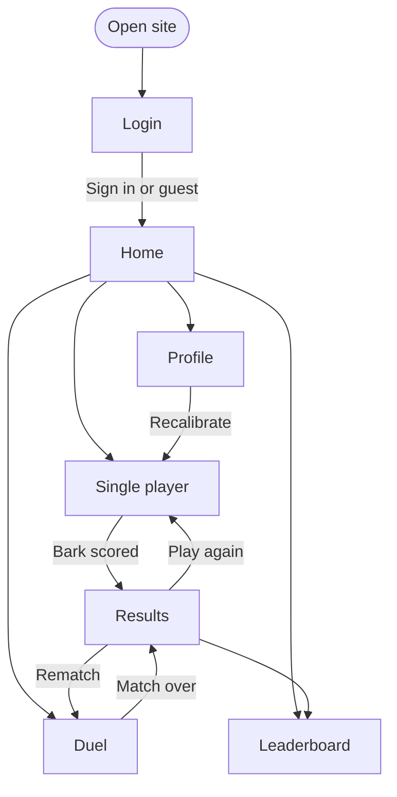

# Pages and user flow

The plan for the frontend's pages: where players go, what works today, and what each page is waiting on. The game itself is described in the root README.

## User flow

Two parts of this aren't wired yet. Nothing sends you to Login, so the site opens on Home. Solo shows its score on the page instead of going to Results.

## Pages

| Route | Page | Status | What's real today | What it's waiting on |
| --- | --- | --- | --- | --- |
| `/login` | Login | Stub | Continue as guest | Auth provider; email, Google and Apple sign-in |
| `/` | Home | Partly real | Mode cards, Mic check | Accounts for Your record; leaderboard API for Top dogs |
| `/solo` | Single player | **Real** | The whole recorder: record, countdown, calibration, camera check, scoring | Saving a personal best; sending the score to Results |
| `/duel` | Duel | Stub | Layout only, sample opponent | Matchmaking queue, realtime server, synced rounds |
| `/results` | Results | Stub | Layout only, sample match | Duels for real rounds; a solo version |
| `/profile` | Profile | Partly real | Mic check | Accounts, Elo, match history, clip replay |
| `/leaderboard` | Leaderboard | Stub | Layout only, sample players | Leaderboard API |

Anything else redirects to Home. Sample content lives in `src/sampleData.ts`, and every stub says so on the page. As a real API lands, delete its export and the compiler will point at each place to replace.

## Suggested build order

1. **Solo to Results.** Move recorder state above the routes so takes survive navigation, then send a scored take to Results. This is the only step that needs no backend work beyond the scorer.
2. **Mic check gate.** Send first-time players to calibration before their first bark.
3. **Accounts.** Login, then the real Home and Profile numbers.
4. **Duel.** Queue, match found, synced rounds, then Results and Elo.
5. **Leaderboard.** Comes almost free once duels record Elo.

## Decisions needed

- **Solo rules.** The README says one bark per run, 15 seconds. The page still has the recorder's 3 to 15 second lengths and unlimited retakes. Which do we ship?
- **Mic check placement.** The README puts it before sign-in. It could also be a step inside Single player, which is where it lives now. A dedicated page would be an eighth route.
- **Score scale.** The API returns 0 to 1, so a great bark reads `0.83`. Would `83` feel more like a game? It's a display-only change, but it should be consistent across every page.
- **Guest play.** Can guests play ranked duels, or only solo? This decides whether Duel redirects to Login.
- **Stack.** The README lists Next.js and Tailwind, but the frontend is Vite, React Router and plain CSS. Either update the README or plan the move before more pages are built.

## Working on a page

Each page is one `.tsx` and one `.css` file in `src/pages/`, so two people on different pages shouldn't touch the same files. To add a page, create those two files and add one line to the route table in `src/App.tsx`. Shared styles live in `src/index.css`; change them with care, because every page uses them.
